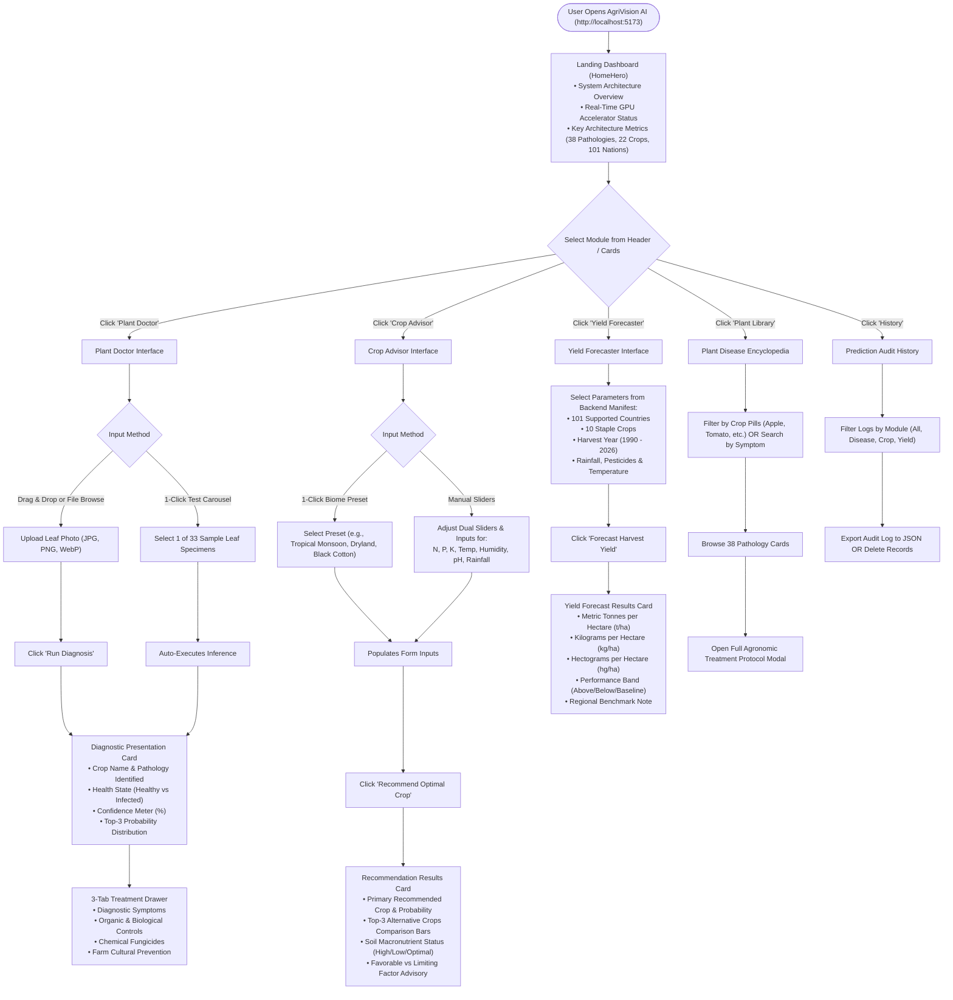
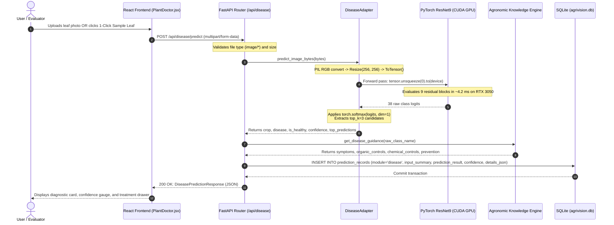
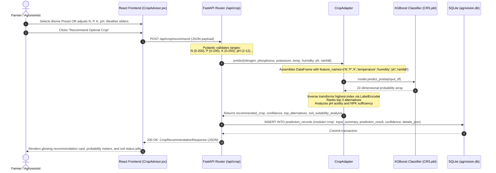
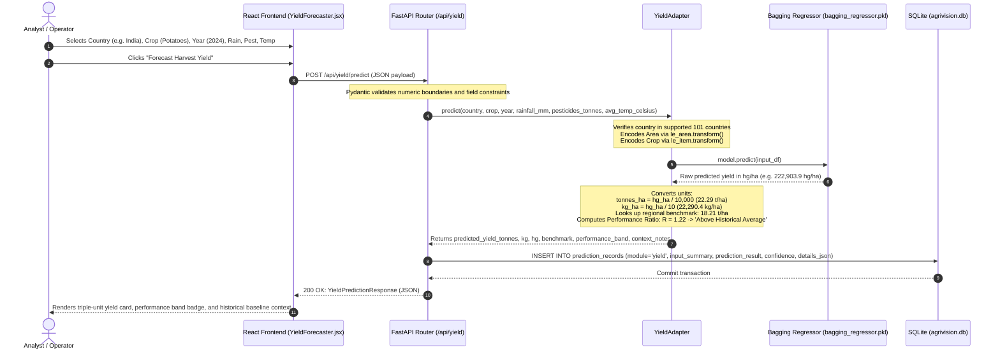
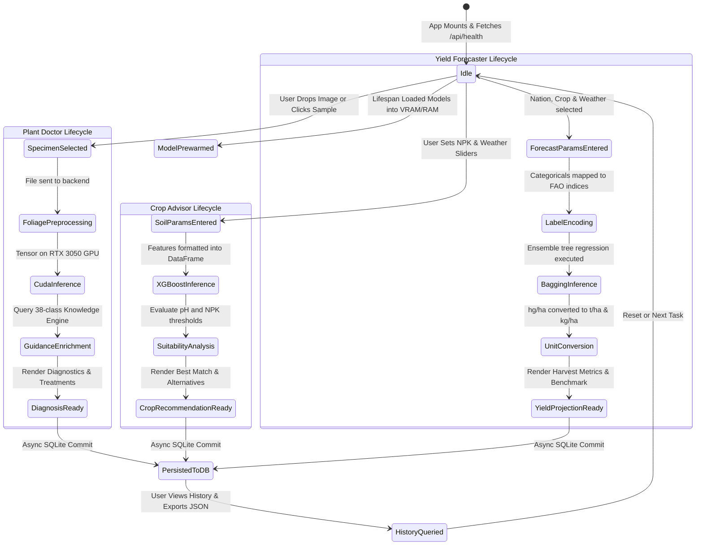
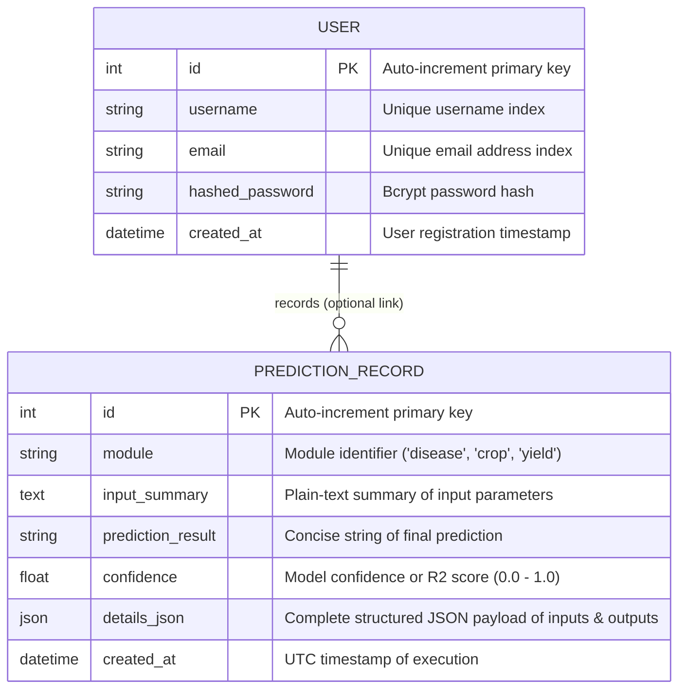

# 🌾 AgriVision AI — Architecture, App Flow & Working Diagrams

This document provides a visual and structural blueprint of the **AgriVision AI** platform, detailing its system topology, user navigation flow, and exact runtime execution mechanisms across all machine learning engines.

---

## 1. High-Level Multi-Tier Architecture Diagram

The system follows a decoupled, multi-tier enterprise architecture separating client rendering, RESTful API orchestration, accelerated machine learning inference, and data persistence.

```mermaid
flowchart TD
    subgraph "Tier 1: Presentation Tier (Client Layer)"
        UI["React 19 SPA (Vite 6, Port 5173)"]
        UI_Sub1["Tailwind CSS v4 Design System"]
        UI_Sub2["Lucide Reactive Icons"]
        UI_Sub3["Dark / Light Mode Controller"]
        UI_Sub4["1-Click Test Specimen Carousel"]
        UI --> UI_Sub1
        UI --> UI_Sub2
        UI --> UI_Sub3
        UI --> UI_Sub4
    end

    subgraph "Tier 2: Application & API Gateway Tier"
        API["FastAPI ASGI Server (Uvicorn, Port 8000)"]
        Router["API Router (/api)"]
        CORS["CORS Middleware"]
        Lifespan["Lifespan Startup Manager\n(Pre-warms all 3 ML models in memory)"]
        Pydantic["Pydantic v2 Schema Validator"]
        
        API --> CORS
        API --> Lifespan
        API --> Router
        Router --> Pydantic
    end

    subgraph "Tier 3: Machine Learning & Analytical Engine Tier"
        subgraph "Engine A: Plant Doctor"
            AD_Disease["Disease Adapter"]
            Torch_CNN["PyTorch ResNet9 CNN (26.4 MB)\n(CUDA 12.6 on RTX 3050 Laptop GPU)"]
            KB_Engine["Curated Agronomic Knowledge Engine\n(38 Pathology Treatment Records)"]
            AD_Disease --> Torch_CNN
            AD_Disease --> KB_Engine
        end

        subgraph "Engine B: Crop Advisor"
            AD_Crop["Crop Adapter"]
            XGB_Model["XGBoost Multi-Class Classifier (1.67 MB)\n(22 Crop Output Classes)"]
            Heuristic["Soil Adequacy Heuristic Analyzer"]
            AD_Crop --> XGB_Model
            AD_Crop --> Heuristic
        end

        subgraph "Engine C: Yield Forecaster"
            AD_Yield["Yield Adapter"]
            Bagging_Model["Scikit-Learn Bagging Regressor (151 MB)\n(101 Nations, 10 Food Crops)"]
            Baseline["Regional Historical Benchmark Calculator"]
            AD_Yield --> Bagging_Model
            AD_Yield --> Baseline
        end
    end

    subgraph "Tier 4: Storage & Persistence Tier"
        DB_Engine["SQLAlchemy ORM Engine"]
        SQLite[("agrivision.db (SQLite / PostgreSQL)\nTable: prediction_records\nTable: users")]
        Disk_Test["Static Disk Storage\ntest/test/ (33 Leaf Specimens)"]
        DB_Engine --> SQLite
    end

    %% Inter-Tier Connections
    UI -->|HTTP POST / GET / Multipart (via Vite Proxy)| API
    Pydantic -->|Foliage Image Bytes| AD_Disease
    Pydantic -->|7 Soil & Weather Features| AD_Crop
    Pydantic -->|Area, Crop, Rain, Pest, Temp| AD_Yield
    API -->|Session Audit Logging| DB_Engine
    API -->|Serve Specimen Images| Disk_Test
```

---

## 2. User Experience & Application Navigation Flow

This flowchart illustrates how users and evaluators navigate through the web interface, from the landing overview to the specialized functional modules.



---

## 3. Working Mechanism: Plant Doctor Sequence Diagram

This sequence diagram depicts the exact chronological data flow when diagnosing a crop leaf, including image transformation, CUDA execution, and database persistence.



---

## 4. Working Mechanism: Crop Advisor Sequence Diagram

This sequence diagram illustrates how the Crop Advisor validates soil macronutrients and environmental drivers, computes multi-class probabilities, and generates agronomic suitability advice.



---

## 5. Working Mechanism: Yield Forecaster Sequence Diagram

This sequence diagram shows how the Yield Forecaster validates country/crop inputs against the FAO manifest, performs label encoding, predicts harvest yields, and computes regional performance bands.



---

## 6. End-to-End Data State Lifecycle Diagram

This state transition diagram illustrates how data transforms throughout the entire lifecycle of an AgriVision AI user session.



---

## 7. Database Entity Relationship (ER) Diagram

The persistence schema captures all diagnostic and predictive workflows into auditable records.


